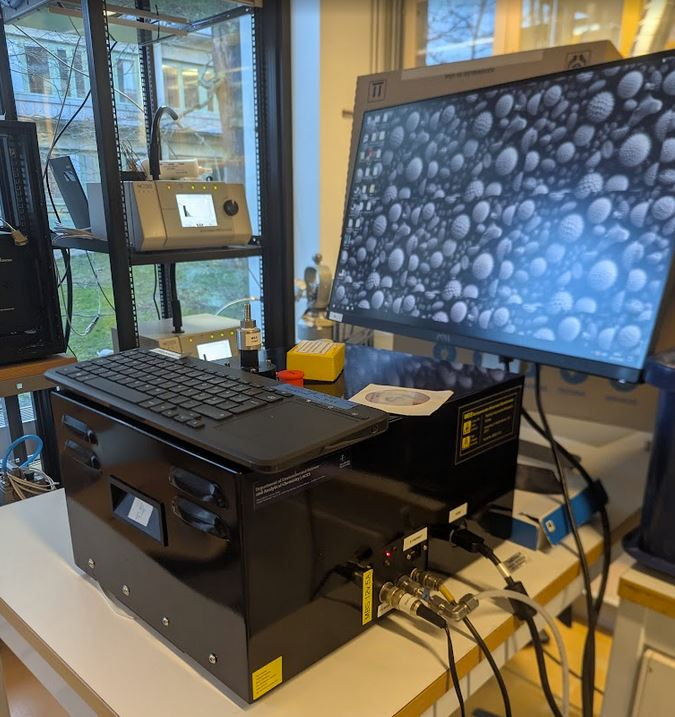
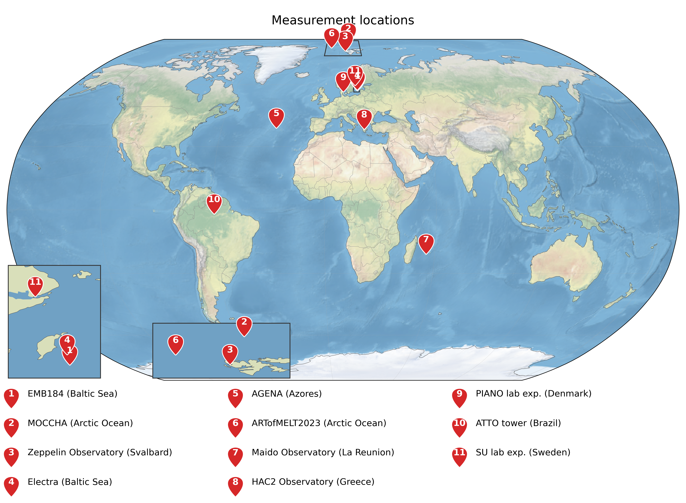

# Multiparameter Bioaerosol Spectrometer (MBS)

**Atmospheric Science Unit · Department of Environmental Science · Stockholm University**

The MBS measures size, optical shape and UV-induced fluorescence of single coarse-mode particles. We use it to find bioaerosols in Arctic air, in clouds and in sea spray. This repository collects the group's MBS code, publications and open data in one place.

  
   <em>The Stockholm University MBS (University of Hertfordshire, UK).</em>

| Channel | A | **B** | C | D | E | F | G | H |
|---|---|---|---|---|---|---|---|---|
| Centre wavelength (nm) | 315 | **364** | 414 | 461 | 508 | 552 | 595 | 640 |

Excitation at 280 nm (xenon flash). 

**Contents:** [Field campaigns](#field-campaigns) · [Code](#code) · [Publications](#publications) · [Theses](#theses) · [Data](#data) · [Contact](#contact)

---

## Field campaigns

MBS measurement locations so far: ship campaigns, observatories and laboratory experiments.

  

---

## Code

| Repository | Description |
|---|---|
| [SU-air/instrumentation-MBS-berrygarden](https://github.com/SU-air/instrumentation-MBS-berrygarden) | MBS functions collected by Gabriel Pereira Freitas during his PhD (2023), including the processing behind the fPBAP classification. Modules: `mulberry` (MBS), `cloudberry` (CVI), `acaiberry`, `blossom`, `juniperberry`. Fork of [Gabrielpfreitas/BerryGarden](https://github.com/Gabrielpfreitas/BerryGarden). |
| [aidenrobert/MBS-source-characterization](https://github.com/aidenrobert/MBS-source-characterization) | Laboratory source characterization code from Jönsson et al. (2026). Archived version: [Zenodo](https://doi.org/10.5281/zenodo.22086099). |
| [aidenrobert/truffle](https://github.com/aidenrobert/truffle) | TRUFFLE: machine-learning classification of MBS particles, combining fluorescence and morphology (Jönsson et al., 2026). Archived version: [Zenodo](https://doi.org/10.5281/zenodo.22086175). |

---

## Publications

Peer-reviewed papers and book chapters from the Stockholm group based on MBS measurements or that include MBS measurements, newest first and numbered from the oldest (1).

9\. **Jönsson, A.**, Fu, J., Pereira Freitas, G., Crawford, I., Dagsson-Waldhauserová, P., Krejci, R., Tobo, Y., Yttri, K. E., and Zieger, P. (2026). Tracing biological, anthropogenic, and inorganic sources of coarse aerosols via single-particle fluorescence and optical morphology. *Atmos. Chem. Phys.*, 26, 13617–13643. [doi:10.5194/acp-26-13617-2026](https://doi.org/10.5194/acp-26-13617-2026)

8\. **Pereira Freitas, G.**, Kojoj, J., Mavis, C., Creamean, J., Mattsson, F., Nilsson, L., Spicker Schmidt, J., Adachi, K., Šantl-Temkiv, T., Ahlberg, E., Mohr, C., Riipinen, I., and Zieger, P. (2025). A comprehensive characterisation of natural aerosol sources in the high Arctic during the onset of sea ice melt. *Faraday Discussions*, 258. [doi:10.1039/d4fd00162a](https://doi.org/10.1039/d4fd00162a)

7\. **Kojoj, J.**, Pereira Freitas, G., Muilwijk, M., Granskog, M. A., Naakka, T., Ekman, A. M. L., Heutte, B., Schmale, J., Da Silva, A., Lapere, R., Marelle, L., Thomas, J. L., Melsheimer, C., Murray, B. J., and Zieger, P. (2024). An Arctic marine source of fluorescent primary biological aerosol particles during the transition from summer to autumn at the North Pole. *Tellus B*, 76(1), 47–70. [doi:10.16993/tellusb.1880](https://doi.org/10.16993/tellusb.1880)

6\. **Zinke, J.**, Pereira Freitas, G., Foster, R. A., Zieger, P., Nilsson, E. D., Markuszewski, P., and Salter, M. E. (2024). Quantification and characterization of primary biological aerosol particles and microbes aerosolized from Baltic seawater. *Atmos. Chem. Phys.*, 24, 13413–13428. [doi:10.5194/acp-24-13413-2024](https://doi.org/10.5194/acp-24-13413-2024)

5\. **Pereira Freitas, G.**, Kopec, B., Adachi, K., Krejci, R., Heslin-Rees, D., Yttri, K. E., Hubbard, A., Welker, J. M., and Zieger, P. (2024). Contribution of fluorescent primary biological aerosol particles to low-level Arctic cloud residuals. *Atmos. Chem. Phys.*, 24, 5479–5494. [doi:10.5194/acp-24-5479-2024](https://doi.org/10.5194/acp-24-5479-2024)

4\. **Zinke, J.**, Freitas, G., Salter, M. E., Lundin, D., Aggarwal, S., Zieger, P., Mohr, C., and Foster, R. A. (2024). Quantification and characterization of microbial emissions over the Northeastern Atlantic using mesocosm experiments. *ACS ES&T Air*, 1(3). [doi:10.1021/acsestair.3c00017](https://doi.org/10.1021/acsestair.3c00017)

3\. **Pereira Freitas, G.**, Adachi, K., Conen, F., Heslin-Rees, D., Krejci, R., Tobo, Y., Yttri, K. E., and Zieger, P. (2023). Regionally sourced bioaerosols drive high-temperature ice nucleating particles in the Arctic. *Nature Communications*, 14, 5997. [doi:10.1038/s41467-023-41696-7](https://doi.org/10.1038/s41467-023-41696-7)

2\. **Pasquier, J. T.**, David, R. O., Freitas, G., Gierens, R., Gramlich, Y., Haslett, S., Li, G., Schäfer, B., Siegel, K., Wieder, J., Adachi, K., Belosi, F., Carlsen, T., Decesari, S., Ebell, K., Gilardoni, S., Gysel-Beer, M., Henneberger, J., Inoue, J., Kanji, Z. A., Koike, M., Kondo, Y., Krejci, R., Lohmann, U., Maturilli, M., Mazzolla, M., Modini, R., Mohr, C., Motos, G., Nenes, A., Nicosia, A., Ohata, S., Paglione, M., Park, S., Pileci, R. E., Ramelli, F., Rinaldi, M., Ritter, C., Sato, K., Storelvmo, T., Tobo, Y., Traversi, R., Viola, A., and Zieger, P. (2022). The Ny-Ålesund Aerosol Cloud Experiment (NASCENT): Overview and first results. *Bulletin of the American Meteorological Society*, 103(11), E2533–E2558. [doi:10.1175/BAMS-D-21-0034.1](https://doi.org/10.1175/BAMS-D-21-0034.1)

1\. **Freitas, G. P.**, Stolle, C., Kaye, P. H., Stanley, W., Herlemann, D. P. R., Salter, M. E., and Zieger, P. (2022). Emission of primary bioaerosol particles from Baltic seawater. *Environ. Sci.: Atmos.*, 2, 1170–1182. [doi:10.1039/d2ea00047d](https://doi.org/10.1039/d2ea00047d)

---

## Theses

- **Pereira Freitas, G.** (2023). *Bioaerosols and their importance for low-level Arctic clouds.* PhD thesis, Department of Environmental Science, Stockholm University. [urn:nbn:se:su:diva-223503](https://urn.kb.se/resolve?urn=urn:nbn:se:su:diva-223503)
- **Fu, J.** (2022). *Characterisation of aerosol particles relevant for the Arctic using a light-induced-fluorescence and light-scattering method.* MSc thesis (45 ECTS), Master's Programme in Environmental Science, Stockholm University.

---

## Book chapters

- **Zieger, P.**, Zinke, J., Pereira Freitas, G., and Salter, M. (2025). Release of primary biological aerosol particles from surface waters. Chapter 7 in: Morris, C. E., Kobziar, L. N., Christner, B. C., Garros, C., and De Vleeschouwer, F. (eds.), *Biological Highways in the Sky*. Éditions Quae, Versailles. [doi:10.35690/978-2-7592-4126-2](https://doi.org/10.35690/978-2-7592-4126-2) (open access)

---

## Data

Open-access datasets on the [Bolin Centre Database](https://bolin.su.se/data/) that contain MBS measurements (ODC-By licence).

| Dataset | Platform · period | Used in |
|---|---|---|
| [MBS laboratory characterization of coarse-mode particles: processed data](https://doi.org/10.17043/jonsson-2026-aerosol-mbs-1) (Jönsson et al.) | Lab | [ACP 2026](https://doi.org/10.5194/acp-26-13617-2026) |
| [MBS laboratory characterization of coarse-mode particles: raw data](https://doi.org/10.17043/jonsson-2026-aerosol-mbs-raw-1) (Jönsson et al.) | Lab | [ACP 2026](https://doi.org/10.5194/acp-26-13617-2026) |
| [Natural aerosol source samples from expedition ARTofMELT, Arctic Ocean](https://doi.org/10.17043/oden-artofmelt-2023-aerosol-source-samples-1) (Kojoj et al.) | Oden · 2023 | [Faraday Discuss. 2025](https://doi.org/10.1039/d4fd00162a) |
| [Bioaerosols, bacteria and ionic composition in sea spray from Baltic Sea experiments](https://doi.org/10.17043/zinke-2024-baltic-bioaerosols-1) (Zinke et al.) | Baltic Sea · 2021 | [ACP 2024](https://doi.org/10.5194/acp-24-13413-2024) |
| [Bioaerosols, bacteria and ionic composition in sea spray from mesocosm experiments in the Azores](https://doi.org/10.17043/zinke-2023-mesocosm-azores-1) (Zinke et al.) | Azores | [ACS ES&T Air 2024](https://doi.org/10.1021/acsestair.3c00017) |
| [fPBAP concentrations in low-level Arctic cloud residuals, Svalbard](https://doi.org/10.17043/zeppelin-freitas-2023-bioclouds-1) (Pereira Freitas et al.) | Zeppelin · 2019–2021 | [ACP 2024](https://doi.org/10.5194/acp-24-5479-2024) |
| [Single-particle measurements of fluorescent bioaerosols during the Arctic Ocean 2018 expedition](https://doi.org/10.17043/oden-ao-2018-aerosol-mbs-1) (Kojoj et al.) | Oden · 2018 | [Tellus B 2024](https://doi.org/10.16993/tellusb.1880) |
| [Bioaerosols and ice nucleating particles at Zeppelin Observatory, Svalbard](https://doi.org/10.17043/zeppelin-freitas-2023-bioaerosols-1) (Freitas et al.) | Zeppelin · 2017–2020 | [Nat. Commun. 2023](https://doi.org/10.1038/s41467-023-41696-7) |

---

## Contact

Paul Zieger, Department of Environmental Science, Stockholm University · paul.zieger@aces.su.se

The MBS was developed by the University of Hertfordshire (Paul Kaye, Warren Stanley).
